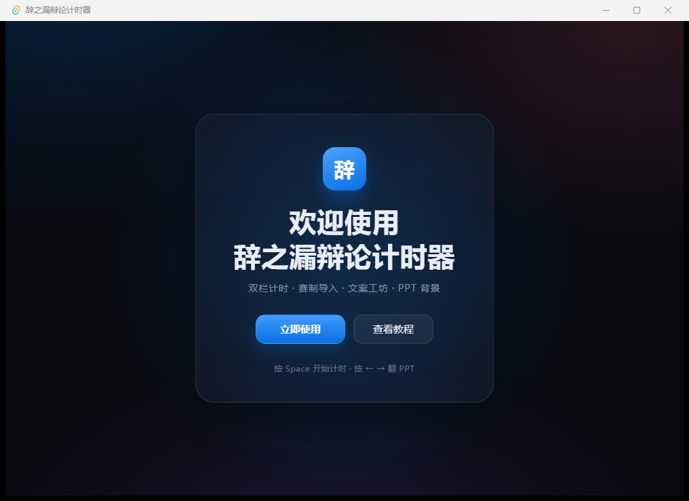
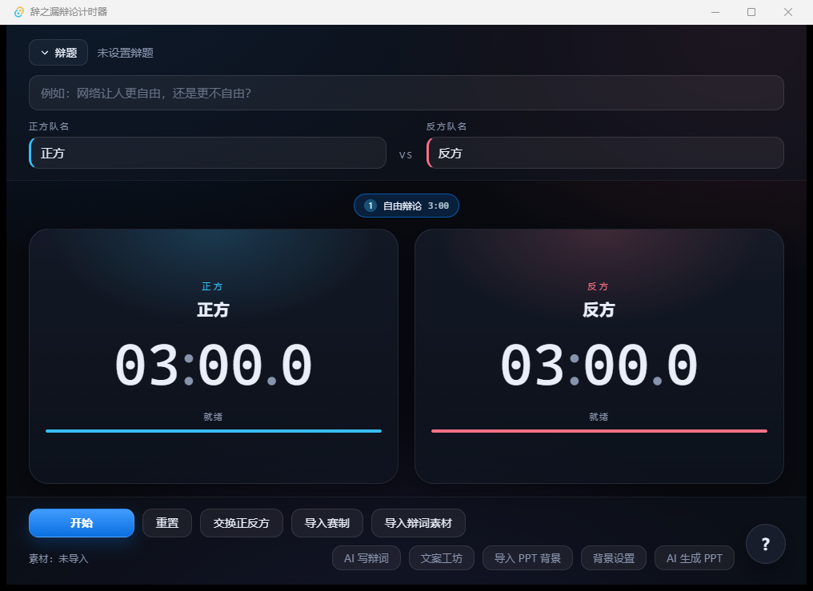
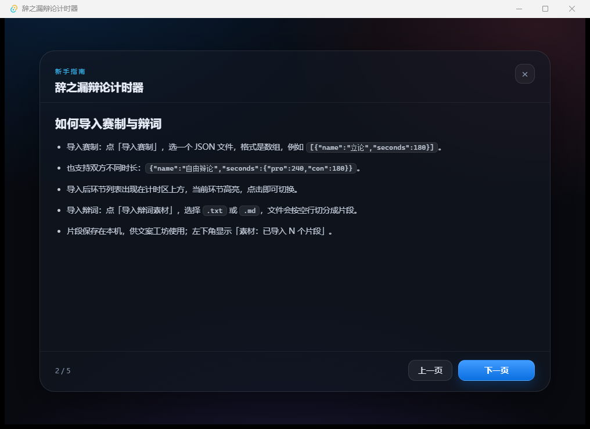
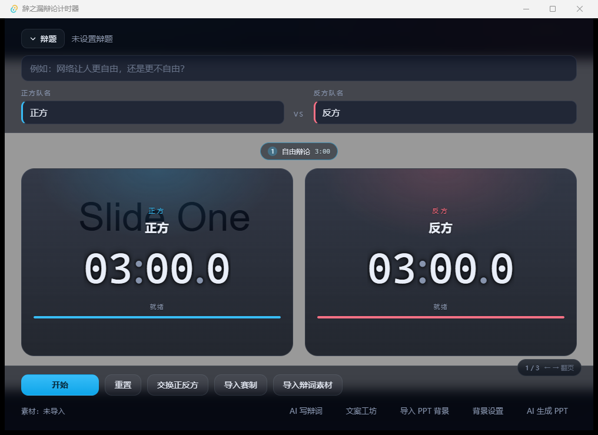
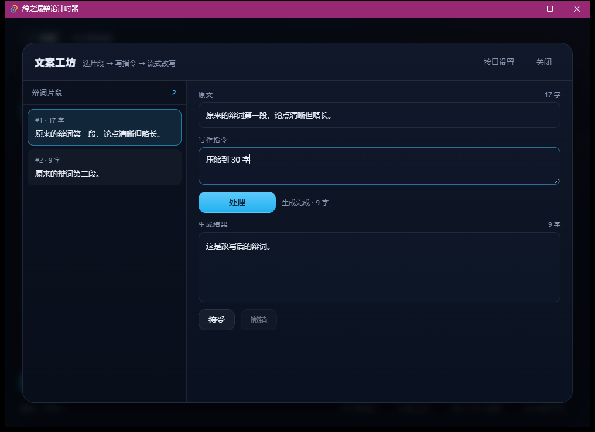

# yilun-yingfa-tauri-debate-timer
辞之漏 辩论计时器（包含文案工坊＋导入PPT＋ai改辩词＋一键导入赛制），非web端含赛制辩论计时器
# 辞之漏辩论计时器
辞之漏辩论计时器 —— Tauri 2.0 桌面应用。双栏计时 + 赛制/辩题导入 + OpenAI 兼容文案工坊 + PPT 背景 + AI 工具导航。

原生 HTML/CSS/JavaScript 前端，没有 React/Vue，也没有打包器；所有网络请求走 Rust。







## 定位与技术栈

- **Rust 后端 + 系统 WebView2 渲染，NSIS 安装包约 15–20 MB。**
- 计时、主题、帮助页都在本地运行，离线可用；只有「文案工坊」会访问你自己配置的 OpenAI 兼容接口。

## 功能

- **双栏计时**：正 / 反方独立倒计时，0.1 秒精度；剩余 30s / 5s / 归零提示音（Web Audio 合成，无音频文件）
- **赛制导入**：JSON 定义环节与双方时长，环节芯片可点击切换
- **辩题与队名**：折叠式辩题输入，队名实时同步到计时卡片
- **文案工坊**：导入 `.txt` / `.md` 辩词片段，按指令流式改写、接受 / 撤销；API Key 只存本机
- **PPT 背景**：`.pdf` 直接渲染，`.pptx` 由本机 LibreOffice 转换；全屏 canvas + 遮罩 + 文字描边保护
- **AI 工具导航**：豆包 / DeepSeek / 通义千问 / Gamma / 夸克 PPT 的提示词与跳转
- **欢迎页与帮助页**：5 页图文教程，右下角悬浮帮助按钮





## 可选依赖

- **PPT 背景导入需要安装 LibreOffice；未安装时可手动导出 PDF 导入。**
  （`.pptx` 会调用 `soffice --headless --convert-to pdf`，产物缓存在应用数据目录的 `ppt-cache/`）

## 隐私声明

> **AI 写辩词 / AI 生成 PPT 仅打开外部网页，本应用不调用豆包/DeepSeek/千问/Gamma 的 API。文案工坊的 API Key 仅存储在本地，由用户自行配置 base_url。**

- 所有设置保存在本机 `%APPDATA%\com.cizhilou.debate-timer\debate-store.json`
- 文案工坊的请求由 Rust 发出；日志不记录 API Key 与完整请求体
- 应用不含任何统计、遥测或自动联网行为

## 构建

```bash
npm install
npm run tauri dev      # 开发：编译 Rust 并打开窗口
npm run tauri build    # 发布：生成 NSIS / MSI 安装包
```

首次编译需要下载并编译数百个 crate（5–15 分钟），之后增量编译在 1 分钟内。

发布产物：

```
src-tauri/target/release/bundle/nsis/辞之漏辩论计时器_0.1.0_x64-setup.exe
src-tauri/target/release/bundle/msi/辞之漏辩论计时器_0.1.0_x64_zh-CN.msi
```

打包配置（`src-tauri/tauri.conf.json`）：`bundle.targets = ["nsis", "msi"]`，
`bundle.windows.webviewInstallMode = { "type": "downloadBootstrapper" }`（约 2 MB 引导器，
不使用 `offlineInstaller`，避免安装包膨胀 200 MB+）。
WiX 语言设为 `zh-CN`，否则中文产品名会触发 MSI 的 codepage 1252 报错。

> 当前构建实测：NSIS **4.0 MB**、MSI **4.9 MB**——比「约 15–20 MB」小，是因为用了
> `downloadBootstrapper`，WebView2 运行时在安装时按需下载，不打进安装包。

## 使用说明

### 计时

顶部填辩题和队名，中间两栏分别是正方 / 反方剩余时间。点「开始」或按 <kbd>Space</kbd> 启动，
双方独立倒计时；再次点击暂停。剩余 30s、5s、归零会响提示音，归零的一栏停在 `00:00.0` 并变红。
「重置」回到环节预设，「交换正反方」互换两队的名字与剩余时间。

### 导入赛制

点「导入赛制」选择 JSON：

```json
[
  { "name": "开篇立论", "seconds": 180 },
  { "name": "驳论", "seconds": 120 },
  { "name": "自由辩论", "seconds": { "pro": 240, "con": 180 } }
]
```

必须是**非空数组**，每项要有非空 `name` 和正数 `seconds`（或 `{ "pro", "con" }`）；
不合法会整体拒绝并提示「JSON 格式不正确，请检查 name 和 seconds 字段」，不会崩溃。

### 导入辩词

点「导入辩词素材」选择 `.txt` / `.md`，按空行切分为片段，存入本地供文案工坊使用。

### 文案工坊

1. 点「文案工坊」→「接口设置」，填 Base URL（如 `https://api.deepseek.com/v1`）、API Key、模型（如 `deepseek-chat`）
2. 左侧选片段，输入写作指令（「压缩到 80 字」「改为质询口吻」），点「处理」
3. 内容流式出现，点「接受」替换原文，点「撤销」回退

请求全部由 Rust 的 `stream_completion` 发出（SSE 解析后通过事件推给前端），前端不 fetch。

### PPT 背景

点「导入 PPT 背景」选 `.pdf` 或 `.pptx`。<kbd>←</kbd> <kbd>→</kbd> 或点击画面左右半区翻页；
「背景设置」可调遮罩 0–60%、切换文字描边黑 / 白、移除背景。

### 快捷键

| 键 | 作用 |
| --- | --- |
| `Space` | 开始 / 暂停 |
| `R` | 重置 |
| `S` | 交换正反方 |
| `←` `→` | PPT 翻页（仅主界面、有背景时） |
| `Esc` | 关闭弹窗 / 关闭帮助页 |

## 项目结构

```
.
├── package.json                 # 前端依赖与脚本（dev / build / vendor）
├── scripts/vendor.mjs           # 把插件与 pdf.js 复制到 src/vendor 并改写裸模块名
├── src/
│   ├── index.html               # 欢迎页 / 计时主界面 / 帮助页 + 各类弹窗
│   ├── styles.css               # macOS 风格玻璃层、圆角、弹性动效
│   ├── main.js                  # 计时状态机、导入、持久化、提示音
│   ├── screens.js               # welcome / main / help 页面切换与帮助分页
│   ├── workshop.js              # 文案工坊
│   ├── guides.js                # AI 写辩词 / AI 生成 PPT 教程弹窗
│   ├── ppt.js                   # PPT 背景渲染与翻页
│   └── vendor/                  # npm run vendor 生成（插件 + pdf.js 本地副本）
├── docs/                        # 截图
└── src-tauri/
    ├── tauri.conf.json          # 窗口 / 打包 / CSP
    ├── capabilities/default.json# 权限
    └── src/lib.rs               # stream_completion + convert_pptx_to_pdf
```

## 数据与设置

`%APPDATA%\com.cizhilou.debate-timer\debate-store.json` 保存：

| key | 内容 |
| --- | --- |
| `topic` / `teams` | 辩题与两队队名 |
| `formatJson` / `phaseIndex` | 上次导入的赛制与当前环节 |
| `scriptSegments` | 辩词片段 |
| `llmConfig` | Base URL / API Key / 模型 |
| `bgConfig` | PPT 遮罩浓度与描边颜色 |

想恢复出厂状态：删除该文件后重启应用。

## 技术备注

- **没有打包器**：`npm run vendor` 把 `@tauri-apps/plugin-*` 与 `pdfjs-dist` 复制到 `src/vendor`，
  并把 `@tauri-apps/api/*` 改写成相对路径，浏览器可直接 `import`。
- **CSP**：`script-src 'self' 'unsafe-eval'; worker-src 'self' blob:`，pdf.js 的 worker 自托管，不走 CDN。
- **Rust 命令**：`stream_completion`（SSE 流式）、`convert_pptx_to_pdf`（LibreOffice 转换 + 缓存）。

## 排错

- **缺少 C++ Build Tools**：安装 Visual Studio Build Tools 的「使用 C++ 的桌面开发」工作负载后重开终端。
  ```powershell
  winget install Microsoft.VisualStudio.2022.BuildTools --override "--wait --passive --add Microsoft.VisualStudio.Component.VC.Tools.x86.x64 --add Microsoft.VisualStudio.Component.Windows11SDK.22621"
  ```
- **`cargo` 找不到**：`rustup default stable` 或重开终端让 PATH 生效。
- **PPT 导入提示 LibreOffice**：安装 <https://www.libreoffice.org/download/>，或手动把 PPT 另存为 PDF 再导入。
- **dev 构建的 exe 双击报 127.0.0.1 拒绝连接**：`target\debug` 是 dev 产物，需要 `tauri dev` 的本地服务；
  要独立运行请用 `npm run tauri build` 的安装包。

## 建议仓库信息

- 仓库名：`yilun-yingfa-tauri-debate-timer`
- GitHub Description：`Tauri 2.0 辩论计时器 + 文案工坊 + PPT 背景，非 Web 端赛制生成器。`
